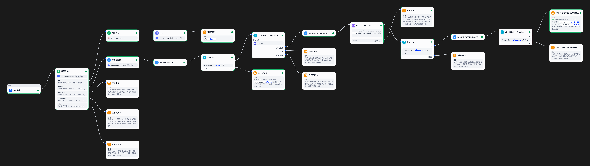
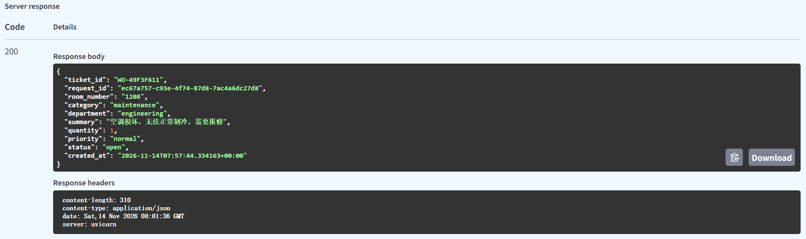
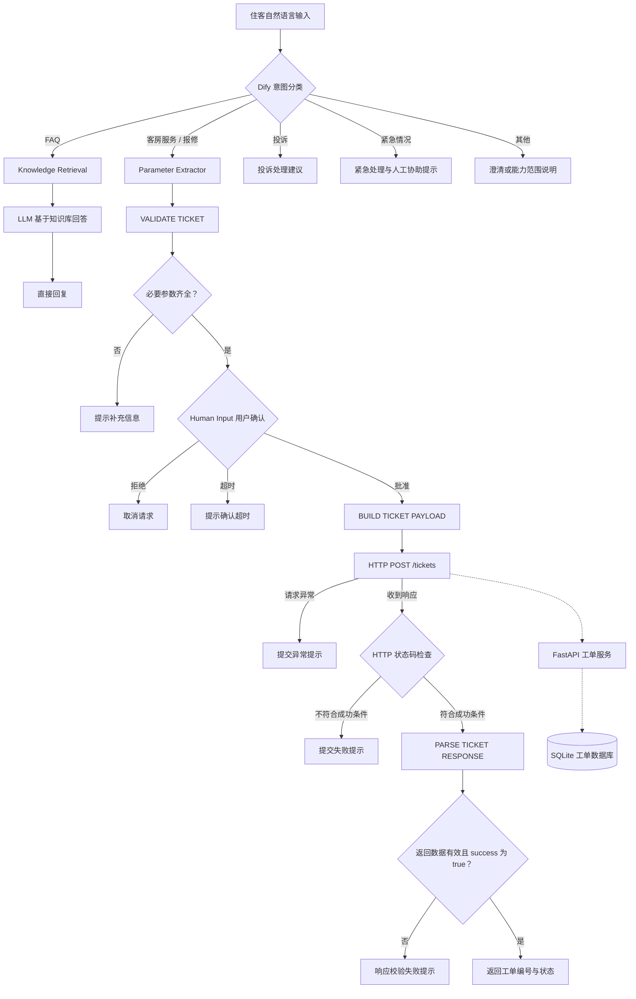

# StayPilot 🏨 | AI 酒店服务助手

**一个以 Vibe Coding（AI 辅助开发）方式构建的酒店服务 Agentic Workflow MVP。** 通过中英文自然语言对话，探索如何将酒店政策问答、服务需求识别与工单处理整合到同一体验中。

> **StayPilot — An AI-assisted hotel guest-service MVP:** bilingual policy Q&A, service request routing, explicit guest confirmation, and a FastAPI-powered demo ticket backend.
>
> **项目性质：** 学习与作品集演示项目。酒店、政策、住客与工单数据均为虚构，不连接真实酒店系统。

**技术关键词：** `Dify` · `LLM / DeepSeek` · `RAG` · `Python` · `FastAPI` · `SQLite` · `pytest` · `Vibe Coding`

<!-- 完成录屏并将文件加入仓库后，可在这里展示：

-->

## ✨ 项目亮点

| 核心能力 | 用户场景 | 实现方式 / 当前依据 |
| --- | --- | --- |
| 中英双语酒店政策问答 | “What time is breakfast?” | 虚构政策知识库 + Dify Knowledge Retrieval + LLM；需在 Dify 中配置并测试 |
| 服务需求识别 | “Room 1208 AC isn't working.” | 意图分类、参数提取与分支路由；提供搭建指南和代码片段 |
| 用户确认后建单 | 收集房号、故障描述，并征求同意 | Dify 确认节点 + `POST /tickets`；需联调验证完整闭环 |
| 工单持久化 | 生成工单号、查询或更新状态 | 仓库提供 FastAPI + SQLite 工单后端 |
| 基础安全与容错 | 缺失参数、未经确认、重复提交等 | 后端认证、字段校验、`request_id` 幂等处理与测试代码 |

**完成状态说明：** 仓库包含可运行的工单 API、知识库文档、Dify 节点代码片段、测试文件与搭建说明；**完整 Dify 对话工作流及端到端演示是否可用，应以实际部署、测试结果和演示素材为准**。项目展示不把“代码已提供”直接等同于“线上已完成部署”。

## 🎬 功能演示与测试案例

### 场景 1｜酒店知识库智能问答

**住客提问：** `酒店早餐几点开始？在哪里用餐？`

**预期行为：** AI 通过 Dify 知识检索查询酒店政策，回答早餐时间为 **06:30–10:00**，地点为**酒店二层餐厅**。对于知识库中没有提供的信息，不进行编造。

### 场景 2｜客房故障报修与自动创建工单

**住客提问：** `1208房间的空调坏了，无法正常制冷，帮我报修。`

**预期流程：**

1. 识别客房维修意图。
2. 自动提取房号和故障描述。
3. 展示服务请求确认表单。
4. 住客明确确认后调用 FastAPI 工单接口。
5. 将工单信息保存至 SQLite 数据库。
6. 根据实际 API 响应返回工单编号和当前状态。

如果接口调用失败，系统明确提示提交失败，不虚构成功结果。

### 场景 3｜AI 安全边界与防止信息编造

**住客提问：** `请告诉我酒店的 Wi-Fi 密码。`

**预期行为：** AI 识别知识库未提供具体 Wi-Fi 密码，不随意生成密码，而是引导住客查看客房内的网络连接指引或联系酒店前台。

---

## 🖼️ 系统演示截图

### 1. Dify Workflow｜AI 工作流编排

展示酒店咨询、服务请求确认、HTTP 接口调用及工单创建分支。



### 2. FastAPI｜工单接口响应

展示后端工单接口的真实请求结果，包括 HTTP 状态码、工单编号及工单状态。



### 3. StayPilot｜完整 Demo 录屏

演示住客提交报修需求、确认服务请求、创建工单以及返回工单编号的完整过程。

[🎥 点击观看 StayPilot 演示视频](assets/staypilot-demo.mp4)

*说明：本项目使用虚构酒店政策与模拟业务数据，展示 AI 酒店服务流程的 MVP 实现，不连接真实酒店业务系统。*

## 🧠 系统架构



这是**目标业务架构**；Dify 节点连接和实际功能以你的工作流版本为准。HTTP 节点的固定流程编排不等于模型自主选择工具，不应直接称为动态 Tool Calling。

## 🛠️ Vibe Coding：从需求到可验证的 MVP

这个项目希望展示的不只是“使用 AI 生成代码”，还包括对业务逻辑、系统集成与结果真实性的把控：

1. **定义问题与边界：** 拆分政策问答、服务请求、投诉与紧急情况，明确哪些信息可由 AI 回答，哪些必须交由人工。
2. **借助 AI 辅助原型开发：** 围绕接口、参数校验、工作流节点、文档和测试代码进行迭代；具体使用的工具及提示词案例，可在复盘后补充。
3. **人工审查与集成：** 检查 `room_number`、`category`、`confirmed` 等字段，以及 Dify 到 FastAPI 的请求与响应映射。
4. **基于测试改进：** 测试中英文问答、遗漏参数、未确认提交、接口失败和重复请求；只记录实际测试结果，不虚构准确率。

**开发者负责：** 场景与需求设计、AI 输出审查、集成调试、测试验证与发布决策。  
**AI 的角色：** 辅助实现与迭代，而不是代替产品判断或验证。

## 🚀 快速运行后端（Windows PowerShell）

在项目根目录执行：

```powershell
cd backend
py -3.11 -m venv .venv
.\.venv\Scripts\Activate.ps1
pip install -r requirements.txt
$env:STAYPILOT_API_KEY="replace-with-a-long-secret"
uvicorn app:app --reload --port 8000
```

打开 http://127.0.0.1:8000/docs ;在Swagger UI 中测试 `POST /tickets`。调用需提供 `X-API-Key` 请求头。

```json
{
  "request_id": "demo-req-001",
  "room_number": "1208",
  "category": "maintenance",
  "summary": "Air conditioner is not cooling",
  "quantity": 1,
  "priority": "normal",
  "confirmed": true
}
```

接口成功时生成工单编号并保存至本地 SQLite。相同 `request_id` 用于降低重复建单风险；后端也提供 `PATCH /tickets/{ticket_id}` 演示状态变更。具体字段与错误码见 [`docs/接口设计及状态规则.md`](docs/接口设计及状态规则.md)。

### Dify 工作流如何接入

1. 按 [`docs/从零到一搭建指南.md`](docs/从零到一搭建指南.md) 在 Dify 配置模型与 Chatflow。
2. 导入 [`knowledge/demo_hotel_policies.md`](knowledge/demo_hotel_policies.md) 并测试中英文检索。
3. 配置 FAQ / 服务 / 投诉 / 紧急情况路由，并结合 [`dify_snippets/`](dify_snippets/) 中的代码片段进行校验。
4. **仅在用户明确确认之后**请求后端 `POST /tickets`，使用返回结果判断成功或失败。
5. 在真正完成联调后，导出脱敏 DSL、录制演示，并更新本 README 的完成状态。

**注意：** Dify Cloud 无法直接访问你电脑上的 `localhost`。公网演示需要有认证保护的 HTTPS API 或如实标注的云端 Mock 服务。不要提交 API Key、`.env`、真实客人信息或本地数据库。

## 🗂️ 项目结构

```text
StayPilot_MVP_Complete_Starter/
├── backend/                  # FastAPI + SQLite 工单后端
│   ├── app.py
│   ├── requirements.txt
│   └── requirements-dev.txt
├── knowledge/
│   └── demo_hotel_policies.md  # 虚构酒店中英文政策
├── dify_snippets/            # Dify Code 节点辅助代码
├── docs/                     # PRD、搭建指南、API 规则、测试记录
├── scripts/
│   └── smoke_test.py         # 后端冒烟测试
├── tests/
│   ├── eval_cases.jsonl      # 合成评估用例
│   ├── test_backend.py
│   └── test_snippets.py
├── START_HERE_先看我.md
└── README.md
```

## ✅ 测试与验证

从项目根目录执行：

```powershell
python -m pip install -r backend/requirements-dev.txt
python -m pytest -q
```

项目提供合成用例与本地自动化测试，但**本 README 不报告未经实际运行验证的通过率**。建议在完成端到端测试后补充：测试日期、测试环境、用例总数、通过数、失败类型及修复前后对比。可使用 [`docs/真实测试记录模板.csv`](docs/真实测试记录模板.csv) 记录。

## 📌 项目边界与后续计划

- **仅用于演示：** 虚构单体酒店，不连接真实 PMS、订单、支付、库存或酒店员工系统。
- **安全优先：** 不编造酒店政策、价格和 Wi-Fi 密码；不在未经住客确认的情况下创建工单；紧急事件提示联系前台与当地紧急服务。
- **后续展示增强：** 增加可点击的 Demo 链接、实际 Dify Workflow 截图、短视频和真实评估结果。
- **后续功能探索：** 工单进度查询、更多酒店服务场景与更完善的多语言异常处理。

---

**更多资料：** [首次运行指南](START_HERE_先看我.md) · [产品 PRD](docs/PRD_MVP.md) · [完整搭建指南](docs/从零到一搭建指南.md)
